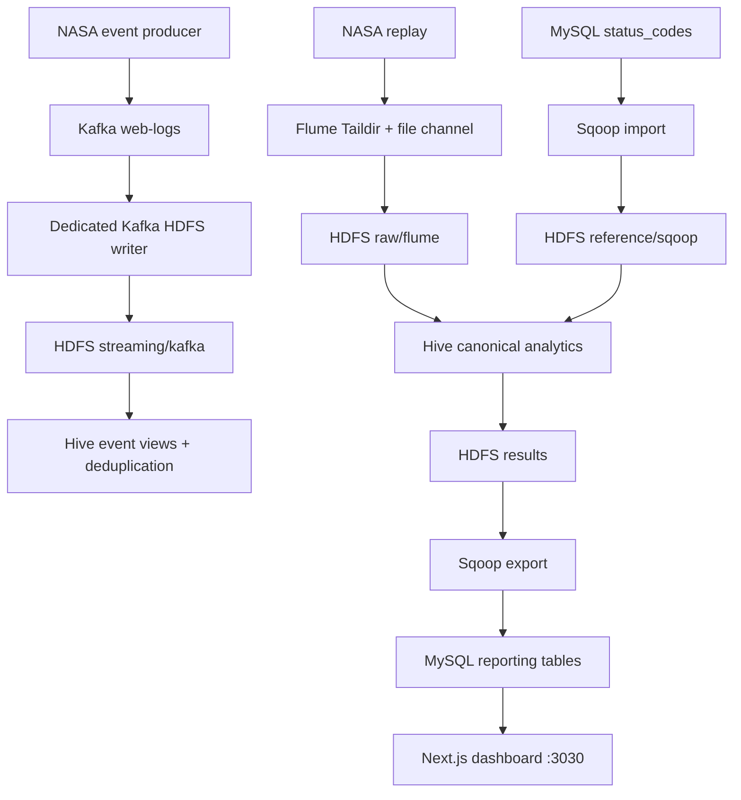

# NASA Web Traffic Analytics — parallel ingestion

Three independently runnable branches converge on HDFS:



Flume and Kafka represent the **same requests**. Only raw Flume data supplies the original six reporting tables. Never add their event counts together. Sqoop import is upstream reference ingestion; Sqoop export is downstream reporting.

## Run

Use Bash/Make (WSL on Windows), Docker Compose and at least 8 GB Docker RAM.

```bash
cp .env.example .env
make data
make build
make up
make pipeline-parallel
make verify-ingestion
# After a FULL NASA run and reporting export:
make verify-analytics
```

The NASA datasets are not included. The image downloads Hadoop/Hive/Flume/Sqoop and verifies checksums; first builds can be slow. The dashboard is at http://localhost:3030.

Independent commands: `make ingest-flume`, `make ingest-kafka`, `make ingest-sqoop`. Each waits for its own replay/import completion; storage rollover and Kafka draining are checked separately by `verify-ingestion`. All-three orchestration launches three child processes concurrently and waits for every exit code without cancelling healthy siblings. `make pipeline` verifies ingress, creates Hive tables, runs unchanged canonical queries and exports results. `make replay` remains a Flume-only background replay alias. `make counts` now performs source-aware reconciliation, including Kafka and Sqoop.

## Contracts and recovery

* Raw: `/data/nasa/raw/flume/dt=YYYY-MM-DD`; original CLF bytes are retained.
* Kafka: `/data/nasa/streaming/kafka/dt=YYYY-MM-DD/part-*.jsonl`.
* Reference: `/data/nasa/reference/sqoop/status_codes`; tab-separated code,label,category.
* Reporting remains under `/data/results`.

Event IDs are SHA-256 of normalized source filename + ':' + physical line number. Identical requests on different lines stay distinct. Kafka retains malformed raw lines and parse errors. Dates use historical server-local calendar dates, consistent with the original Hive SQL; JSON event_time also retains the -0400 offset. Flume timestamps without a parseable date use dt=1970-01-01 and Kafka uses dt=unknown, never today's date.

Producer checkpoints advance after delivery acknowledgments and are guarded by a dataset/topic fingerprint. The writer uploads hidden temporary files, closes them, renames completed files, then synchronously commits Kafka offsets. Delivery is **at least once**: crashes after publication may duplicate physical rows. `nasa_kafka_events_unique` deduplicates by event_id. Hidden Kafka crash debris is ignored, while verification rejects open Flume files. Raw Flume restart behavior also needs runtime reconciliation; file channels do not establish exactly-once delivery.

Sqoop imports into staging, validates contents against MySQL, then replaces the published snapshot, retaining a recoverable backup across the rename window. This is a recoverable two-rename publication, not a transaction: readers may briefly see the final directory absent. Concurrent imports and producer/replayer invocations use locks.

## Dashboard and operations

Live Pipeline shows three branches, per-branch controls, all-three launch, logs and cancellation. The internal control server allows concurrent independent jobs and rejects conflicts. It is not published to the host and accepts fixed commands only. CLI and API executions also share source locks. Pausing/resuming the writer uses `docker compose pause kafka-hdfs-writer` and `docker compose unpause kafka-hdfs-writer`. Producer replay controls do not stop the writer.

Data Explorer browses the three HDFS roots, limited to 200 directory entries and 16 KiB/50 preview lines. React escapes preview text. `/api/pipeline/metrics` reports observed timestamps, measurement sources and unknown values for unavailable services. Writer counters are per process session, while broker offsets and HDFS verification are durable measurements.

`make test-regression` runs the 100-record fixture suite; CI runs it without starting the heavy cluster. `make experiment-kafka-recovery` pauses only the writer, observes Kafka lag and Flume progress, resumes in a finally block, and verifies unique persisted IDs. It requires ongoing traffic and reports INCONCLUSIVE if the evidence is insufficient. `make benchmark-small`, `benchmark-medium` and `benchmark-stress` request 100/1,000/5,000 events/s and save JSON/CSV; they preserve cumulative checkpoints. Use fresh isolated Compose volumes for controlled comparisons. Reports are written under `artifacts/`; unavailable measurements remain null.

## Validation status

The migration has passed fixture unit tests, shell/Python syntax checks, Compose validation, dashboard TypeScript/lint and its production build. HDFS integration, crash recovery and full NASA regression remain **unverified**: the first image build was blocked by very slow upstream Hadoop downloads, and no NASA inputs were present. Benchmark/fault scripts are runnable tooling, not evidence of a successful experiment. See [validation notes](docs/MIGRATION_VALIDATION.md).

Historical baseline expectations (not fresh migration measurements): 3,461,613 raw lines; 33 malformed; /images/NASA-logosmall.gif 208,798 hits; 404 20,871; 500 65; piweba3y.prodigy.com 21,987; peak hour 15. The original README and guides are archived in docs/legacy. Existing PDFs/screenshots describe that prior run and must be regenerated only after a verified new run; do not submit them as parallel-migration evidence.

Use `make down` to preserve volumes. `make clean` deletes datasets and database volumes; it is never used in recovery experiments. Existing pre-migration Kafka messages use a different format: set a new KAFKA_TOPIC (e.g. web-logs-parallel) and use fresh producer state when migrating an existing deployment. Keep old HDFS data/volumes until the new paths have passed reconciliation. New canonical Hive table nasa_logs_raw avoids inheriting stale partition locations from the sequential table.
