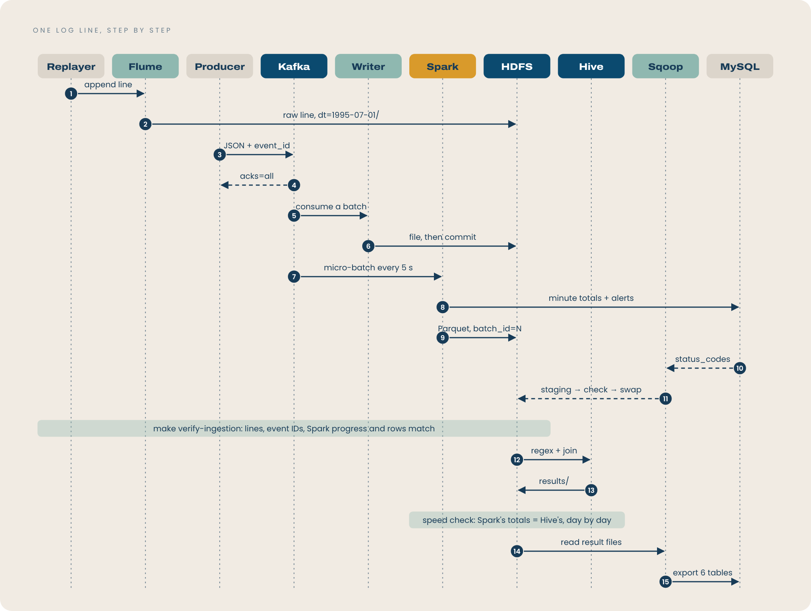

# Web traffic analytics pipeline

Batch and near-real-time analysis of web server access logs with **Flume, Kafka, Spark, HDFS, Hive and Sqoop**, packaged with Docker Compose and driven from a web dashboard. The whole cluster starts with one command, and every step can run from the terminal or from the browser.

The pipeline answers six questions about the NASA Kennedy Space Center web server (July and August 1995, 3,461,613 requests). The first four come from the batch layer, the last two from the speed layer:

1. Which pages are visited the most?
2. How is traffic distributed over the hours of the day?
3. What share of requests end in errors (404, 500)?
4. Who are the most active client hosts?
5. Is anything suspicious happening (traffic spikes, 404 bursts, server errors, one host flooding the server)?
6. Do the two layers agree?

| Document | For |
|---|---|
| [docs/GETTING_STARTED.md](docs/GETTING_STARTED.md) | Running the project from a fresh clone, step by step |
| [docs/PROJECT_EXPLAINED.md](docs/PROJECT_EXPLAINED.md) | How everything works, explained from zero |
| [docs/DEFENSE_PREPARATION.md](docs/DEFENSE_PREPARATION.md) | Detailed architecture, tools, code walkthrough and presentation questions |
| [docs/study.pdf](docs/study.pdf) | Complete study document and recording checklist in the project style |
| [docs/report.pdf](docs/report.pdf) | Project report |
| [docs/slides.pdf](docs/slides.pdf) | Presentation slides |
| [docs/guide.pdf](docs/guide.pdf) | The whole project explained simply, in the report's style |
| [docs/ARCHITECTURE.pdf](docs/ARCHITECTURE.pdf) | Every tool of the Lambda architecture explained, one by one |

## The pipeline

<p align="center"></p>

Three ingestion branches start together and each one ends in HDFS:

| Branch | Path | Result in HDFS |
|---|---|---|
| Flume | Live log, Flume, HDFS sink | Original lines in `/data/nasa/raw/flume`, one folder per day |
| Kafka | Python producer, topic `web-events`, then two consumers | JSON events in `/data/nasa/streaming/kafka` (HDFS writer) and Parquet figures in `/data/nasa/streaming/spark` (Spark) |
| Sqoop | MySQL `status_codes`, checked staging, swap | Reference copy in `/data/nasa/reference/sqoop/status_codes` |

Solid arrows carry the log data; dashed arrows carry the `status_codes` reference table. The batch part then runs on the raw Flume lines: Hive writes its six result tables to HDFS and Sqoop exports them to MySQL. The web dashboard reads the results and the speed tables from MySQL and live metrics from Flume, Kafka, Spark, HDFS and YARN every two seconds. Its buttons run the same scripts as the `make` targets through a control API in the `client` container.

<p align="center"></p>

### Lambda architecture: batch layer and speed layer

Before, Kafka only made a second copy of the same lines that nobody used. Now each path has its own job:

| Layer | Path | Gives | When |
|---|---|---|---|
| Batch | Flume raw lines, Hive, Sqoop export | The exact history, six result tables | After the run |
| Speed | Kafka, Spark Structured Streaming | Per-minute traffic, requests per host and alerts | A few seconds behind the replay |

Spark (service `spark-streaming`, `scripts/spark_speed_layer.py`) reads `web-events` in 5-second micro-batches and computes, per minute, the hits, 4xx, 404, 5xx and bytes, and the requests per host. It writes them to HDFS as Parquet (`/data/nasa/streaming/spark/minute_stats|host_minute/batch_id=N`, read by the Hive tables and views `speed_minute_parts`, `speed_traffic_minute` and `speed_alerts`) and to the MySQL tables `speed_minute`, `speed_host_minute`, `speed_alerts` and `speed_batches`, which feed the dashboard's **Real-time** page.

| Alert | Fires at |
|---|---|
| `traffic_spike` | 300 hits or more in a minute |
| `not_found_burst` | 15 or more 404 in a minute |
| `server_errors` | 3 or more 5xx in a minute |
| `host_flood` | 30 or more requests from one host in a minute |

The thresholds sit above the 99.9th percentile of a normal NASA minute (217 hits, 13 not-found, 16 requests from one host).

**Exactly once.** Each micro-batch writes its own `batch_id` folder in HDFS (overwritten if Spark replays it), and MySQL skips a `batch_id` already in `speed_batches`, which is written in the same transaction as the totals. The read position is the Spark checkpoint in HDFS (`/data/nasa/checkpoints/spark-speed-layer`), kept across `make reset`; on its first start Spark begins at the end of the topic.

**Speed versus batch check.** `hive/05_speed_check.sql` runs at the end of `make hive-analysis` and fails the pipeline unless, for every day, Spark's totals (from Kafka) equal Hive's `hits_per_day` (from Flume's raw lines): two independent paths agreeing. `make verify-ingestion` also waits until Spark has processed the topic to its end.

**Cost.** Spark runs in local mode inside a 2 GB container and adds about 1 to 2 GB of memory.

What happens to one log line:

| Step | What happens |
|---|---|
| 1 | The replayer appends the line to `access.log`. |
| 2 | Flume reads the request time into the event's `timestamp` header and writes the line into the folder of the day of the request, such as `dt=1995-07-01/`. |
| 3 | The Python producer turns the same source line into a JSON event with a stable ID and publishes it to Kafka (`acks=all`). |
| 4 | The HDFS writer closes and publishes a file of events, then commits its Kafka offsets. |
| 5 | Spark reads the event in its next micro-batch and adds it to the totals of its minute, in HDFS and MySQL. |
| 6 | Sqoop copies the `status_codes` table from MySQL into HDFS (a checked staging directory, then a swap). |
| 7 | Hive parses each raw line with its regex and joins the status labels. |
| 8 | Hive writes the six result tables to `/data/nasa/results/`, then checks them against Spark's totals. |
| 9 | Sqoop exports the six tables to MySQL. |

| Tool | Role | Why |
|------|------|-----|
| Flume | Collects log lines and writes them to HDFS | Ready-made sources and sinks for log collection, configured instead of coded |
| Kafka | Topic of structured events with two consumers | Durable and replayable; the HDFS writer and Spark each keep their own position |
| Spark | Speed layer: per-minute traffic and alerts | Structured Streaming with checkpoints and a native Kafka source |
| HDFS | Raw, event, speed-layer and result zones | Distributed, fault-tolerant storage for large files |
| Hive | SQL analysis over HDFS | Queries in SQL, executed as MapReduce jobs on YARN |
| Sqoop | Transfers between MySQL and HDFS | Bulk import and export in both directions |
| MySQL | Reference data, final results, speed tables, Hive metastore | The reporting database a company would actually query |
| Dashboard | Results, real-time page, live pipeline, run controls | Next.js and shadcn/ui; reads MySQL, Kafka, HDFS, YARN and Flume metrics, and starts steps through a small control API in the client container |

Delivery to HDFS is at least once: Hive's `kafka_events_unique` view deduplicates stable event IDs derived from the source file and line number, and `make verify-ingestion` checks exact raw content, acknowledged event IDs, Spark's progress and the reference rows. The speed layer's own results are exactly once.

```bash
make replay RATE=5000 LIMIT=200000  # the three branches; Spark is already listening
make speed-layer                    # latest minutes and alerts written by Spark
make verify-ingestion               # raw content, event IDs, Spark progress, reference rows
make pipeline                       # tables, checks, Hive analysis + speed check, Sqoop export
make verify-analytics               # full-dataset baseline after analysis/export
```

The dashboard has five pages: **01 Overview**, **02 Analytics** ("Six questions, two layers": 01 to 04 from the batch layer plus data quality, **05 Suspicious activity** with Spark's alerts per kind and the top flooding hosts, and **06 Do both layers agree?** with Hive against Spark per day, 58 of 58 days matching), **03 Real-time** (the speed layer: key figures, traffic per minute, alerts and the speed-versus-batch table), **04 Live pipeline** (the data-flow diagram from the MySQL source and the Sqoop import to Hive, the Sqoop export, MySQL and the dashboard, with Kafka's two consumers and Spark writing to MySQL, plus run controls) and **05 Data explorer** (the HDFS zones). Other targets: `ingest-flume`, `ingest-kafka`, `ingest-sqoop`, `pipeline-parallel`, `benchmark-small`, `benchmark-medium`, `benchmark-stress` and `experiment-kafka-recovery`. Run the recovery experiment after a partial ingestion, with at least 60,000 unread source events left. `make test-regression` runs the fixture tests without a running cluster.

### Design decisions

- **Partitioning by event date.** Flume extracts the request time from each line into the event's `timestamp` header. Data from 1995 therefore lands in `dt=1995-07-01`, not in the partition of the ingestion day.
- **Verified delivery.** File channels, Kafka acknowledgements and replay checkpoints support recovery. Physical delivery is at least once: a Flume write timeout can duplicate a raw batch. `make counts` detects extra as well as missing lines; `make verify-ingestion` also checks exact source content and event IDs. A failed raw-data check requires a fresh replay before analysis. Structured Kafka events have a deduplication view in Hive.
- **Two layers that must agree.** The batch layer is exact and late, the speed layer early; the pipeline compares them day by day and fails if they differ.
- **Malformed lines are measured, not hidden.** Lines that don't match the Common Log Format regex are kept in HDFS and counted in the `data_quality` table.
- **Decoupled stages.** Every service runs in its own container. Pausing the Kafka HDFS writer lets messages accumulate in Kafka; when it resumes, it continues from its last committed offset. Spark keeps its own position and is unaffected. The dashboard's live pipeline page shows the lag growing and draining.
- **Single-node scope.** HDFS and YARN run as a pseudo-distributed cluster in one container, and Spark in local mode. This is a deliberate limit for a laptop, not a design flaw: the configuration is the same as on a real cluster, apart from the replication factor and the number of nodes.

## Results

From the full run (all 3,461,613 lines, 0 lost):

| Question | Answer |
|---|---|
| Most requested resource | `/images/NASA-logosmall.gif`, 208,798 requests (first HTML page: `/ksc.html`, 7th) |
| Busiest hour | 15:00 server time, about 3,977 requests per day |
| Errors | 404 Not Found: 20,871 (0.60%); 500 Internal Server Error: 65 (0.002%) |
| Most active host | `piweba3y.prodigy.com` (an ISP proxy), 21,987 requests |
| Data quality | 33 malformed lines (0.001%), kept and counted |
| Suspicious activity | Spark's alerts: `host_flood` in 48 minutes (worst: 69 requests in a minute from `kss2nn.nn.mobitel.telia.se`, 1995-07-20 11:47), `traffic_spike` 16 (worst 405 hits, 1995-07-13 09:49), `not_found_burst` 9 (worst 24, 1995-07-12 10:35), `server_errors` 6 (worst 21, 1995-07-03 10:55) |
| Layers agree | Spark processed 3,461,613 events in 139 micro-batches; Hive and Spark match on all 58 days |

## Quick start

Requirements: Docker with Compose v2, at least **8 GB of RAM** for Docker, about 20 GB of free disk for the full run and document tools, and `make`, `curl`, `gzip`. Full walkthrough per operating system: [docs/GETTING_STARTED.md](docs/GETTING_STARTED.md).

```bash
cp .env.example .env     # optional: replay rate, ports
make data                # download the NASA logs into data/raw (36 MB)
make build               # build the images (first download depends on the connection)
make up                  # start MySQL, Hadoop, Kafka, Spark, Flume, Hive and the dashboard
make db-init             # ensure the reporting database and speed tables exist (safe on existing volumes)
make replay              # replay the logs as live traffic: Flume, Kafka and Sqoop start together
make counts              # once the replay ends: lines replayed vs. lines in HDFS
make speed-layer         # during the replay: Spark's latest minutes and alerts
make pipeline            # tables, branch checks, Hive analysis + speed check, Sqoop export
```

Then open the dashboard at **http://localhost:3030** (the **Real-time** page fills up while the replay runs). `make help` lists every command.

For a full recording, follow the [demo checklist](docs/DEMO.md): exact controls, expected counts, narration and the order of the evidence to show.

**From the browser instead:** after `make up`, the dashboard's *Live pipeline* page starts the three branches (rate and number of lines to choose), the no-loss check and the batch pipeline, or any single step. It follows each run live: an animated flow of every stage with its throughput, the step timeline, the MapReduce jobs on YARN and the log output line by line. The buttons run the same scripts as the `make` targets, through a control API that the `client` container serves on the internal Docker network only.

| Service | URL |
|---------|-----|
| Dashboard | http://localhost:3030 |
| HDFS NameNode | http://localhost:9870 |
| YARN ResourceManager | http://localhost:8088 |
| MapReduce job history | http://localhost:19888 |
| HiveServer2 | http://localhost:10002 |

`make down` stops everything and keeps the data; `make clean` also deletes HDFS, Kafka and MySQL data.

## Repository layout

```
├── docker-compose.yml        services, volumes and ports
├── Makefile                  one command per pipeline step (make help)
├── docker/bigdata/           image with Hadoop 3.3.6, Hive 3.1.3, Flume 1.9.0, Sqoop 1.4.7, Spark 3.5.9
│   ├── Dockerfile            checksum-verified downloads, library fixes
│   ├── entrypoint.sh         picks the container role
│   └── roles/                hadoop, hive, flume, replayer, client
├── config/                   Hadoop, Hive, the Flume agent and architectures.json (paths, topic, databases)
├── mysql/                    databases, users, status_codes, result and speed-layer tables
├── hive/                     table definitions, analytical queries, speed layer and its check
├── sqoop/                    import of status_codes, export of results
├── scripts/                  download, replay, Kafka branch, Spark speed layer, checks, control API
├── dashboard/                Next.js + shadcn/ui web dashboard (its own container)
└── docs/                     guides, report and slides, with their build (docs/build)
```

## Troubleshooting

| Symptom | Fix |
|---------|-----|
| `hive` restarts or stays unhealthy | Hive starts last; check `docker compose logs hive`. It needs MySQL and HDFS to be up first. |
| MapReduce jobs stay in `ACCEPTED` | Open http://localhost:8088/cluster/nodes. If the node is `UNHEALTHY`, free disk space: both the 98.5% utilization limit and the 2 GB minimum apply. Leave additional space for the next run; otherwise give Docker more memory. |
| `spark-streaming` stays unhealthy or the Real-time page is empty | The service becomes healthy once its query has run its first trigger (up to a minute or two after `make up`); the Kafka producer waits for it. Check `docker compose logs spark-streaming` and that Docker has at least 8 GB of memory. |
| Replay or reset fails with `Name node is in safe mode` | Check `df -h`, the NameNode log and `docker compose exec -T hadoop hdfs dfsadmin -report`. If disk exhaustion caused safe mode, free space first, confirm the DataNode is live with no missing blocks, then run `docker compose exec -T hadoop hdfs dfsadmin -safemode leave`. Do not force a replay into old data after a failed reset. |
| Web replay reports insufficient disk space | Choose the first 200,000 lines or free more space. The web control budgets live logs, Kafka and HDFS copies, plus 4 GiB of headroom, before starting a replay. |
| `make build` is very slow | The Dockerfile tries the Apache CDN and a mirror before the throttled official archive. Downloads resume after a dropped connection and finished packages are cached, so rerunning `make build` continues where it stopped. |
| `make data` fails on every mirror | Download the two `.gz` files from a Kaggle copy of the NASA HTTP logs and put them in `data/raw/`. |
| Port already in use | Change `MYSQL_HOST_PORT` or `DASHBOARD_HOST_PORT` in `.env`, or stop the local service using the port. |

`docker compose exec -T client python3 /opt/project/scripts/cluster_ready.py` checks HDFS write readiness and a healthy YARN worker. The Hadoop container uses the same check; an open web UI alone does not mean the cluster can run jobs. A reset checks HDFS before changing anything and clears the replay checkpoints only after HDFS and MySQL have been reset.

## Credentials

All accounts are for local use only:

| Account | Password | Used by |
|---------|----------|---------|
| MySQL `root` | `MYSQL_ROOT_PASSWORD` (default `root`) | administration |
| MySQL `hive` | `hive` | Hive metastore |
| MySQL `sqoop` | `sqoop` | Sqoop import and export, dashboard (read) |

## Rebuilding the report and slides

The PDFs in `docs/` are generated from the live results, so they always match the data. With the stack running and a successful full run recorded:

```bash
make screenshots         # dashboard, HDFS and YARN pages, terminal output
make docs                # docs/report.pdf, docs/slides.pdf and docs/guide.pdf
```

The build tools run in a dedicated Docker service with Chromium; Node and browser packages are not required on the host. The screenshot tool uses the Docker socket to run project commands. Names, course and date on the covers come from `docs/meta.json`.
