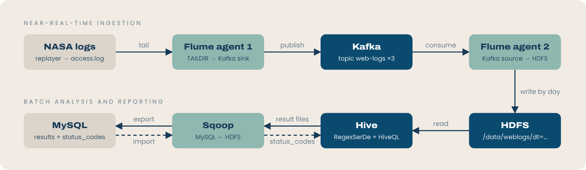
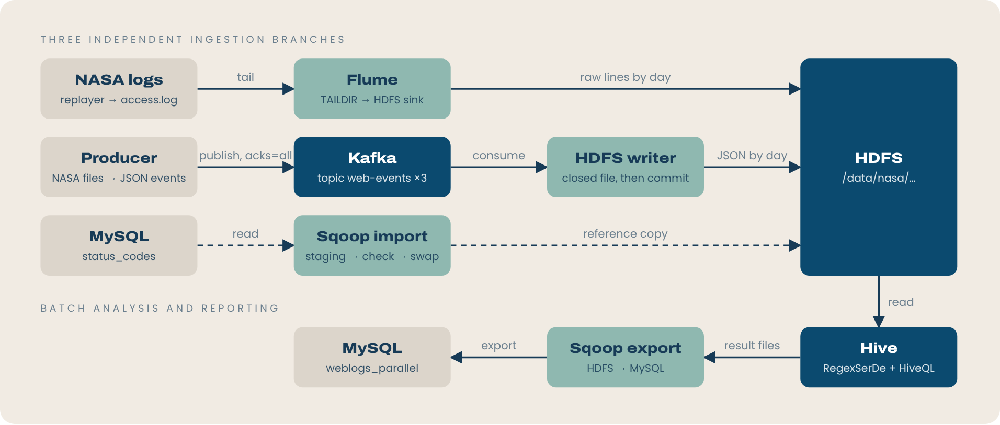
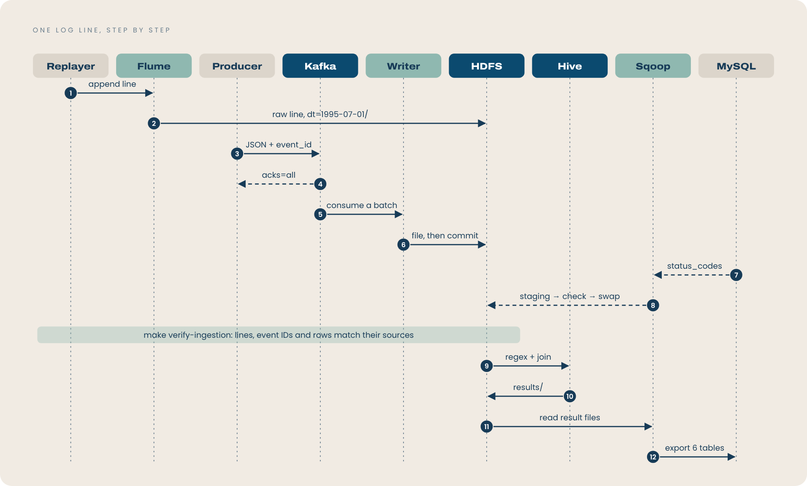

# Web traffic analytics pipeline

Batch and near-real-time analysis of web server access logs with **Flume, Kafka, HDFS, Hive and Sqoop**, packaged with Docker Compose and driven from a web dashboard. The whole cluster starts with one command, and every step can run from the terminal or from the browser.

The pipeline answers four questions about the NASA Kennedy Space Center web server (July and August 1995, 3,461,613 requests):

1. Which pages are visited the most?
2. How is traffic distributed over the hours of the day?
3. What share of requests end in errors (404, 500)?
4. Who are the most active client hosts?

| Document | For |
|---|---|
| [docs/GETTING_STARTED.md](docs/GETTING_STARTED.md) | Running the project from a fresh clone, step by step |
| [docs/PROJECT_EXPLAINED.md](docs/PROJECT_EXPLAINED.md) | How everything works, explained from zero |
| [docs/report.pdf](docs/report.pdf) | Project report |
| [docs/slides.pdf](docs/slides.pdf) | Presentation slides |
| [docs/guide.pdf](docs/guide.pdf) | The whole project explained simply, in the report's style |

## Two architectures

Choose **B · Parallel** (default) or **A · Sequential** with `ARCH=parallel|sequential` on any architecture-aware target, or use the switch in the dashboard's top bar. The cookie `arch` keeps the browser selection; command-line selection is independent. Both run on the same cluster with separate live logs, topics, HDFS folders and Hive/MySQL databases, defined in `config/architectures.json`.

| | A · Sequential | B · Parallel |
|---|---|---|
| Ingestion | Flume 1 → Kafka → Flume 2 | Direct Flume, Python Kafka producer/writer, Sqoop import independently |
| Kafka topic | `web-logs` | `web-events` |
| Canonical raw logs | `/data/weblogs` | `/data/nasa/raw/flume` |
| Structured events | Flume events in Kafka | JSON in `/data/nasa/streaming/kafka`, deduplicated by event ID in Hive |
| Hive / MySQL | `weblogs` | `weblogs_parallel` |

### A · Sequential

<p align="center"></p>

Solid arrows carry the log data: Hive writes its result files to HDFS (`/data/results/`) and Sqoop exports them to MySQL. Dashed arrows carry the `status_codes` reference table, which Sqoop imports from MySQL into HDFS (`/data/reference/`) for the Hive join. The web dashboard reads the results from MySQL and also reads live metrics from Flume, Kafka, HDFS and YARN every two seconds. Its buttons run the same scripts as the `make` targets through a control API in the `client` container.

What happens to one log line:

<p align="center"></p>

| Step | What happens |
|---|---|
| 1 | The replayer appends the line to `access.log`. |
| 2 | Flume agent 1 reads the request time into the event's `timestamp` header and publishes it to Kafka (`acks=all`, headers kept). |
| 3 | Flume agent 2 consumes it (group `flume-hdfs-writer`). |
| 4 | It writes the line into the folder of the day of the request, such as `dt=1995-07-01/`. |
| 5–6 | Sqoop copies the `status_codes` table from MySQL into HDFS. |
| 7 | Hive parses each line with its regex and joins the status labels. |
| 8 | Hive writes the result tables to `/data/results/`. |
| 9–10 | Sqoop reads those files and exports the six tables to MySQL. |

| Tool | Role | Why |
|------|------|-----|
| Flume | Collects log lines and writes them to HDFS | Ready-made sources and sinks for log collection, configured instead of coded |
| Kafka | Buffer between collection and storage | Absorbs traffic spikes; the HDFS writer can stop and resume without losing data |
| HDFS | Raw storage, one folder per day | Distributed, fault-tolerant storage for large files |
| Hive | SQL analysis over HDFS | Queries in SQL, executed as MapReduce jobs on YARN |
| Sqoop | Transfers between MySQL and HDFS | Bulk import and export in both directions |
| MySQL | Reference data, final results, Hive metastore | The reporting database a company would actually query |
| Dashboard | Results, live pipeline, run controls | Next.js and shadcn/ui; reads MySQL, Kafka, HDFS, YARN and Flume metrics, and starts steps through a small control API in the client container |

### B · Parallel

<p align="center"></p>

Flume writes original lines directly to HDFS. A Python producer publishes structured JSON events to Kafka; the HDFS writer closes and publishes each file before committing offsets. Delivery is at least once: Hive's `kafka_events_unique` view deduplicates stable IDs derived from the source file and line number. Sqoop independently imports `status_codes` through a checked staging directory and swaps it into place. The raw Flume branch feeds the same analytical queries and six result tables as A.

<p align="center"></p>

### Compare A and B

```bash
make compare RATE=5000 LIMIT=200000  # smoke comparison; confirms reset of both architectures
make compare RATE=5000 LIMIT=0       # full dataset, A first, then B
make runs                            # persisted JSON records with measurements and fingerprints
make verify-ingestion                # B: raw content, acknowledged event IDs, reference rows
make verify-analytics ARCH=parallel   # full-dataset baseline after analysis/export
```

Verified full run ([record `a0c1eb6ebd18`](docs/evidence/full-comparison.json)):

| Measurement | A · Sequential | B · Parallel |
|---|---:|---:|
| Source/HDFS lines | 3,461,613 | 3,461,613 |
| Every line written (s) | 702.4 | 703.6 |
| Every raw file closed (s) | 761.3 | 711.2 |
| Batch part (s) | 898.5 | 958.3 |
| Peak observed Kafka lag | 28,500 | 162,238 |
| Raw HDFS files | 59 | 59 |
| Result tables | All six identical | All six identical |

Delivery times are nearly equal. The earlier closure in B follows its shorter idle timeout. B also writes structured JSON; its batch part includes source reconciliation, while A imports reference data during its batch part.

Page **04 Compare** runs the same control API job, shows progress in both columns and reports whether the six result tables have identical row counts and SHA-256 fingerprints. Timings distinguish every line written from every raw file closed: A and B use different rollover timers. Full-run measurements, rather than estimates, are the source for the report's comparison table.

Run `make experiment-kafka-recovery` after a partial B ingestion, with at least 60,000 unread source events left. A completed full replay has no new events for the probe; use a fresh partial ingestion before testing recovery.

Page **05 Data explorer** browses the selected architecture's HDFS zones. **Live pipeline** shows A as one chain and B as three independent branches. B also has `ingest-flume`, `ingest-kafka`, `ingest-sqoop`, `pipeline-parallel`, `benchmark-small`, `benchmark-medium`, `benchmark-stress`, and `experiment-kafka-recovery` targets. `make test-regression` runs the fixture tests without a running cluster.

### Design decisions

- **Partitioning by event date.** Flume agent 1 extracts the request time from each line into the event's `timestamp` header, and Kafka carries the header to agent 2 (`useFlumeEventFormat`). Data from 1995 therefore lands in `dt=1995-07-01`, not in the partition of the ingestion day.
- **Verified delivery.** File channels, Kafka acknowledgements and replay checkpoints support recovery. Physical delivery is at least once: a Flume write timeout can duplicate a raw batch. `make counts` detects extra as well as missing lines; B’s `make verify-ingestion` also checks exact source content and event IDs. A failed raw-data check requires a fresh replay before analysis. Structured Kafka events have a deduplication view in Hive.
- **Malformed lines are measured, not hidden.** Lines that don't match the Common Log Format regex are kept in HDFS and counted in the `data_quality` table.
- **Decoupled stages.** Every service runs in its own container. Stopping `flume-agent2` lets messages accumulate in Kafka; when it restarts, it resumes from its last committed offset. The dashboard's live pipeline page shows the lag growing and draining.
- **Single-node scope.** HDFS and YARN run as a pseudo-distributed cluster in one container. This is a deliberate limit for a laptop, not a design flaw: the configuration is the same as on a real cluster, apart from the replication factor and the number of nodes.

## Results

From the full run (all 3,461,613 lines, 0 lost):

| Question | Answer |
|---|---|
| Most requested resource | `/images/NASA-logosmall.gif`, 208,798 requests (first HTML page: `/ksc.html`, 7th) |
| Busiest hour | 15:00 server time, about 3,977 requests per day |
| Errors | 404 Not Found: 20,871 (0.60%); 500 Internal Server Error: 65 (0.002%) |
| Most active host | `piweba3y.prodigy.com` (an ISP proxy), 21,987 requests |
| Data quality | 33 malformed lines (0.001%), kept and counted |

## Quick start

Requirements: Docker with Compose v2, at least **8 GB of RAM** for Docker, about 20 GB of free disk for the full comparison and document tools, and `make`, `curl`, `gzip`. Full walkthrough per operating system: [docs/GETTING_STARTED.md](docs/GETTING_STARTED.md).

```bash
cp .env.example .env     # optional: replay rate, ports
make data                # download the NASA logs into data/raw (36 MB)
make build               # build the images (first download depends on the connection)
make up                  # start MySQL, Hadoop, Kafka, Flume, Hive and the dashboard
make db-init             # ensure both reporting databases exist (safe on existing volumes)
make replay              # replay the logs as live traffic
make counts              # once the replay ends: lines replayed vs. lines in HDFS
make pipeline            # ARCH-aware tables, reference/verification, Hive analysis, Sqoop export
```

Then open the dashboard at **http://localhost:3030**. `make help` lists every command.

**From the browser instead:** after `make up`, the dashboard's *Live pipeline* page starts the replay (rate and number of lines to choose), the no-loss check and the batch pipeline, or any single step. It follows each run live: an animated flow of every stage with its throughput, the step timeline, the MapReduce jobs on YARN and the log output line by line. The buttons run the same scripts as the `make` targets, through a control API that the `client` container serves on the internal Docker network only.

| Service | URL |
|---------|-----|
| Dashboard | http://localhost:3030 |
| HDFS NameNode | http://localhost:9870 |
| YARN ResourceManager | http://localhost:8088 |
| MapReduce job history | http://localhost:19888 |
| HiveServer2 | http://localhost:10002 |

`make down` stops everything and keeps the data; `make clean` also deletes HDFS, Kafka and MySQL data.

## Repository layout

```
├── docker-compose.yml        services, volumes and ports
├── Makefile                  one command per pipeline step (make help)
├── docker/bigdata/           image with Hadoop 3.3.6, Hive 3.1.3, Flume 1.9.0, Sqoop 1.4.7
│   ├── Dockerfile            checksum-verified downloads, library fixes
│   ├── entrypoint.sh         picks the container role
│   └── roles/                hadoop, hive, flume, replayer, client
├── config/                   Hadoop, Hive and both Flume agents
├── mysql/init/               databases, users, status_codes and result tables
├── hive/                     table definitions and analytical queries
├── sqoop/                    import of status_codes, export of results
├── scripts/                  download, replay, no-loss check, shared shell helpers
├── dashboard/                Next.js + shadcn/ui web dashboard (its own container)
└── docs/                     guides, report and slides, with their build (docs/build)
```

## Troubleshooting

| Symptom | Fix |
|---------|-----|
| `hive` restarts or stays unhealthy | Hive starts last; check `docker compose logs hive`. It needs MySQL and HDFS to be up first. |
| MapReduce jobs stay in `ACCEPTED` | Open http://localhost:8088/cluster/nodes. If the node is `UNHEALTHY`, free disk space (at least 2 GB must stay free); otherwise give Docker more memory. |
| `make build` is very slow | The Dockerfile tries the Apache CDN and a mirror before the throttled official archive. Downloads resume after a dropped connection and finished packages are cached, so rerunning `make build` continues where it stopped. |
| `make data` fails on every mirror | Download the two `.gz` files from a Kaggle copy of the NASA HTTP logs and put them in `data/raw/`. |
| Port already in use | Change `MYSQL_HOST_PORT` or `DASHBOARD_HOST_PORT` in `.env`, or stop the local service using the port. |

## Credentials

All accounts are for local use only:

| Account | Password | Used by |
|---------|----------|---------|
| MySQL `root` | `MYSQL_ROOT_PASSWORD` (default `root`) | administration |
| MySQL `hive` | `hive` | Hive metastore |
| MySQL `sqoop` | `sqoop` | Sqoop import and export, dashboard (read) |

## Rebuilding the report and slides

The PDFs in `docs/` are generated from the live results, so they always match the data. With the stack running and a successful full comparison recorded:

```bash
make screenshots         # dashboard, HDFS and YARN pages, terminal output
make docs                # docs/report.pdf, docs/slides.pdf and docs/guide.pdf
```

The build tools run in a dedicated Docker service with Chromium; Node and browser packages are not required on the host. The screenshot tool uses the Docker socket to run project commands. Names, course and date on the covers come from `docs/meta.json`.
