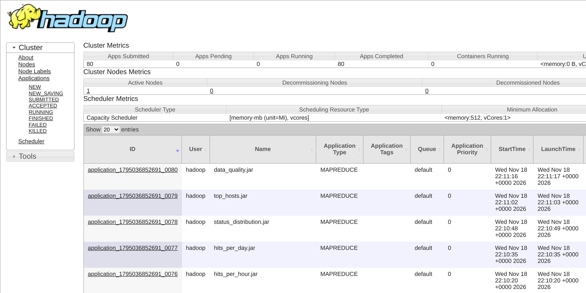
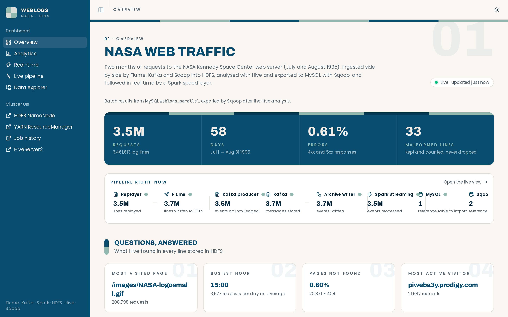
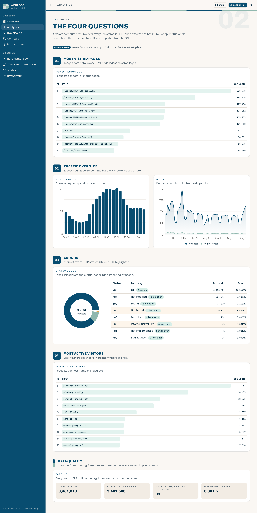
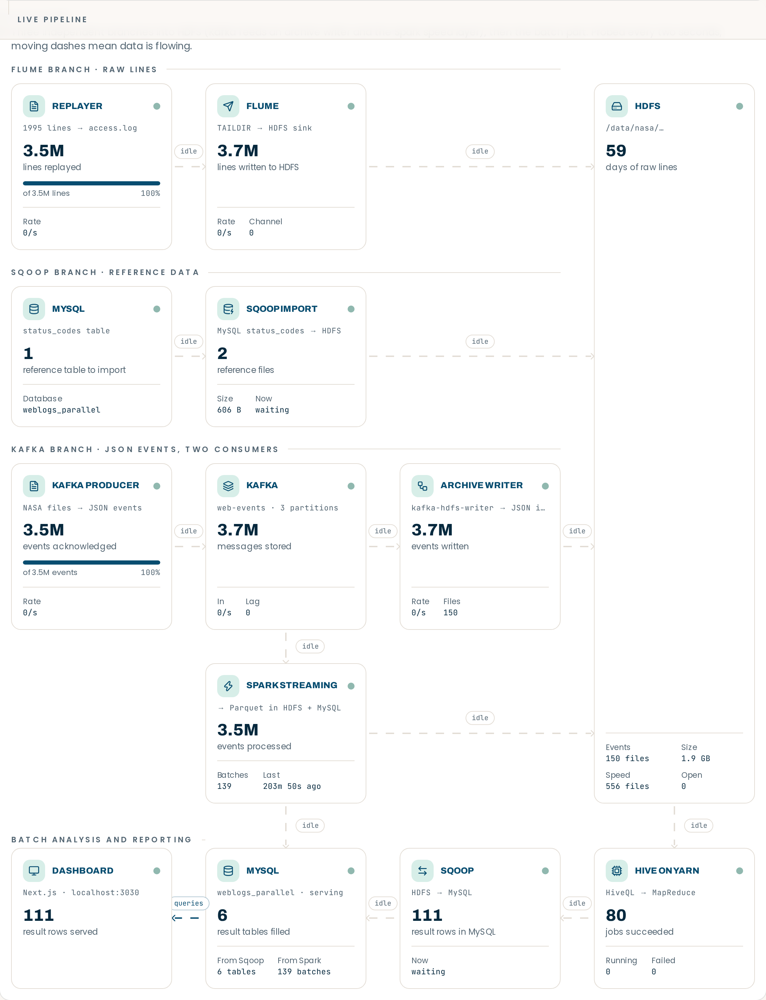
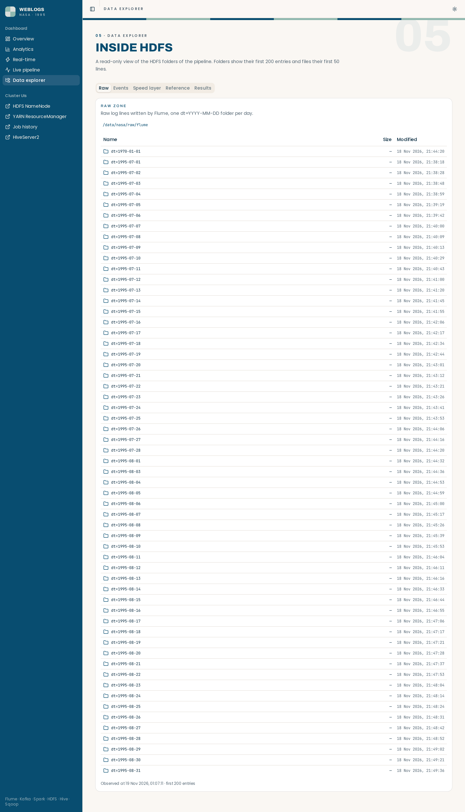

# Getting started

This guide takes you from an empty machine to a running pipeline and a live demo. You do not need to know Docker. Run every command in a terminal, from the project folder, unless the guide says otherwise.

## 1. What you will have at the end

By the end you will have a small big data cluster running on your laptop inside Docker containers. It replays two months of real NASA web server logs (July and August 1995) like live traffic. Three ingestion branches start together: Flume writes the raw lines to HDFS, Kafka carries structured events (archived in HDFS and read by Spark Structured Streaming for live per-minute figures and alerts), and Sqoop imports reference data. Hive analyses the raw lines, Sqoop moves the results into MySQL, and a web dashboard shows everything, including a Real-time page fed by Spark.

Web pages you can open in your browser:

| Page | Address |
|------|---------|
| Project dashboard | http://localhost:3030 |
| HDFS (NameNode) | http://localhost:9870 |
| YARN (ResourceManager) | http://localhost:8088 |
| MapReduce job history | http://localhost:19888 |
| HiveServer2 | http://localhost:10002 |

## 2. Requirements

| Resource | Needed | Notes |
|----------|--------|-------|
| RAM | 8 GB free for Docker | A machine with 16 GB is recommended. Spark alone adds about 1 to 2 GB |
| Disk | At least 20 GB free for the full run and document tools | YARN refuses to run jobs when less than 2 GB stays free |
| CPU | 4 cores recommended | 2 cores work, just slower |
| Internet | Only for the first build | About 1.1 GB for the project image (plus the Spark download), about 1.2 GB for the MySQL, Kafka and ZooKeeper images, about 36 MB for the dataset |

## 3. Install the prerequisites

You need four tools: Docker (runs the containers), Docker Compose (starts many containers together), `make` (short commands for long ones) and `curl`/`gzip` (download and check the dataset). Follow the section for your system.

### Linux (Ubuntu or Debian)

1. Install Docker Engine and the Compose plugin by following the official guide: https://docs.docker.com/engine/install/ (pick your distribution). On Ubuntu the package to install at the end is `docker-ce docker-ce-cli containerd.io docker-compose-plugin`.
2. Let your user run Docker without `sudo`:

   ```bash
   sudo usermod -aG docker $USER
   ```

   Then log out and log back in (or reboot). This step is required, otherwise every command fails with "permission denied".
3. Install the small tools:

   ```bash
   sudo apt update && sudo apt install -y make curl gzip git
   ```

   (On Fedora: `sudo dnf install make curl gzip git`. On Arch: `sudo pacman -S make curl gzip git`.)

### macOS

1. Install Docker Desktop: https://www.docker.com/products/docker-desktop/ (choose Apple Silicon or Intel). Start it once and wait until the whale icon says it is running.
2. In Docker Desktop, open Settings, then Resources, and give it at least 8 GB of memory.
3. Install the Xcode command line tools, which provide `make` and `git`:

   ```bash
   xcode-select --install
   ```

`curl` and `gzip` are already part of macOS.

### Windows

The project runs inside Linux, so on Windows you use WSL2 (a Linux system built into Windows).

1. Open PowerShell as Administrator and run:

   ```powershell
   wsl --install -d Ubuntu
   ```

   Reboot when asked, then open "Ubuntu" from the Start menu and choose a user name and password.
2. Install Docker Desktop: https://www.docker.com/products/docker-desktop/. During setup keep "Use WSL 2 based engine" checked.
3. In Docker Desktop, open Settings, then Resources, then WSL integration, and turn on the switch for Ubuntu.
4. Give WSL enough memory. Create the file `C:\Users\<your-name>\.wslconfig` with:

   ```ini
   [wsl2]
   memory=10GB
   ```

   Then run `wsl --shutdown` in PowerShell and restart Docker Desktop.
5. From now on, run every command in the **Ubuntu terminal**, not in PowerShell or CMD. Install the small tools there:

   ```bash
   sudo apt update && sudo apt install -y make curl gzip git
   ```

6. Clone the project inside the Linux file system (for example in `~/`), not under `/mnt/c/...`. Files on `/mnt/c` are many times slower for Docker.

### Check your setup

Run these three commands. Each must print a version number, not an error.

```bash
docker --version
docker compose version
make --version
```

Also check that Docker itself answers:

```bash
docker run --rm hello-world
```

## 4. Get the project

```bash
git clone https://github.com/JedidiAymen/weblogs-pipeline.git
cd weblogs-pipeline
```

Optionally create your own settings file:

```bash
cp .env.example .env
```

The project works without it. If you create it, these are the variables you can change:

| Variable | Default | Meaning |
|----------|---------|---------|
| `MYSQL_ROOT_PASSWORD` | `root` | Password of the MySQL `root` account |
| `MYSQL_HOST_PORT` | `3307` | Port of MySQL on your machine (3307 avoids a clash with a MySQL you may already have) |
| `REPLAY_RATE` | `500` | How many log lines per second are replayed |
| `REPLAY_LIMIT` | `0` | How many lines to replay in total (0 = everything, about 3.46 million) |
| `DASHBOARD_HOST_PORT` | `3030` | Dashboard port on your machine |

Type `make help` at any time to list every command.

## 5. Run it step by step

### How the pipeline runs

`make replay` starts the three ingestion branches together: the replayer writes the log that Flume tails, the Kafka producer publishes JSON events to the topic `web-events`, and Sqoop imports the status-code reference data. Kafka has two consumers: the HDFS writer, which archives the events, and Spark (`spark-streaming`, already running since `make up`), which computes per-minute traffic and alerts every 5 seconds. Wait for the replay and the HDFS file rollover, then run `make verify-ingestion` and `make pipeline`. `make mysql` opens the MySQL database `weblogs_parallel`, with its six result tables and its speed tables.

| What | Where |
|---|---|
| Live log | `/data/live/parallel/access.log` |
| Raw HDFS (Flume) | `/data/nasa/raw/flume` |
| JSON events HDFS (Kafka writer) | `/data/nasa/streaming/kafka` |
| Speed layer HDFS (Spark, Parquet) | `/data/nasa/streaming/spark` |
| Kafka topic | `web-events` |
| Hive and MySQL | `weblogs_parallel` |

After `make up`, run `make db-init` to ensure the database and its speed-layer tables exist on an existing MySQL volume. The Hive pipeline creates its extra Kafka and speed views, reconciles the branches before analysis, and ends by checking Spark's daily totals against Hive's. Never truncate a live TAILDIR log manually: use `make reset` while ingestion is idle (it keeps the Kafka topic and Spark's checkpoint).

### Step 1: download the data

```bash
make data
```

Downloads the two NASA log files into `data/raw/` and checks them. Takes under a minute.

Expected output (end):

```
NASA_access_log_Jul95.gz: 1891714 lines
NASA_access_log_Aug95.gz: 1569898 lines
```

These two numbers add up to 3461612. Later the replayer counts 3461613, because one file has no newline at the end, so its last line is counted separately. This is normal.

### Step 2: build the image

```bash
make build
```

Builds one Docker image that contains Hadoop, Hive, Flume, Sqoop, Spark and their tools. The first time takes 10 to 30 minutes, depending on your connection. Later builds reuse the cache and take seconds.

Expected output (end):

```
 ✔ Image weblogs/bigdata:latest    Built
 ✔ Image weblogs/dashboard:latest  Built
```

If the download is interrupted, run `make build` again: it continues where it stopped.

### Step 3: start the services

```bash
make up
make status
```

`make up` starts every container except the replayer. `make status` shows their state. Allow 2 to 3 minutes: the first start of Hive creates its metastore schema.

Expected output of `make status` (shortened):

```
NAME            STATUS
zookeeper       Up
kafka           Up (healthy)
kafka-init      Exited (0)
mysql           Up (healthy)
hadoop          Up (healthy)
hive            Up (healthy)
flume-direct    Up (healthy)
kafka-hdfs-writer Up (healthy)
spark-streaming Up (healthy)
client          Up
dashboard       Up (healthy)
```

`kafka-init` is meant to stop with `Exited (0)`: it only creates the Kafka topic. Run `make status` again until every other service says `Up`, with `(healthy)` where shown. `spark-streaming` becomes healthy once its query has run its first trigger, which can take a minute or two; the Kafka producer waits for it, because Spark starts reading at the end of the topic.

### Step 4: replay the logs

```bash
make replay
```

Starts the three branches: the replayer, which writes the NASA log lines into the log file watched by Flume, at `REPLAY_RATE` lines per second; the Kafka producer, which publishes the same lines as JSON events; and the Sqoop import of the status codes.

How long it takes:

- Default (500 lines/s): about 2 hours for all 3.46 million lines.
- Demo speed: set `REPLAY_RATE=5000` in `.env`, about 12 minutes.
- Quick sample: set `REPLAY_LIMIT=200000` in `.env`, about 1 minute at 5000 lines/s.

Change `.env` before running `make replay`. Follow the progress with:

```bash
make logs
```

Expected lines (press Ctrl+C to stop following; the replay keeps running):

```
16:10:01 [INFO]  352000 lines written, 5007 lines/s
```

### Step 5: look at the data on its way

```bash
make topic-peek
```

Prints 5 messages read from the Kafka topic, so you can see structured events passing through Kafka. A few seconds. Each message is a JSON event: a stable `event_id`, the source file and line, the raw line, the request time with its UTC offset, the day, host, resource, status and bytes.

```bash
make hdfs-ls
```

Lists the HDFS zones written by the three branches (the Flume raw lines, the Kafka JSON events and Spark's Parquet files) with their size. A few seconds. The raw zone has one folder per day, such as `dt=1995-07-01`: its name comes from the request time, not the day of ingestion.

You can also browse them at http://localhost:9870 (Utilities, then Browse the file system), or in the dashboard's *Data explorer*.

### Step 5b: watch the speed layer

While the replay runs:

```bash
make speed-layer
```

Prints how many micro-batches Spark has processed, the latest minutes (hits, errors, bytes) and the latest alerts, read from the MySQL speed tables. The figures move every few seconds. The dashboard's **Real-time** page shows the same data: key figures, traffic per minute, the alerts and a speed-versus-batch table.

Spark raises an alert when a minute reaches 300 hits, 15 not-found or 3 server errors, or when one host sends 30 requests in a minute: all above the 99.9th percentile of a normal NASA minute.

### Step 6: check that nothing was lost

Wait about 1 minute after the replay ends, so Flume closes its last files, then run:

```bash
make counts
```

Compares the number of lines replayed with the number of lines stored in HDFS. Under a minute.

```
17:20:06 [INFO]  lines in source log : 3461613
17:20:06 [INFO]  lines in HDFS       : 3461613
17:20:06 [INFO]  OK: no lines lost
```

### Step 7: run the batch analysis

```bash
make pipeline
```

Runs four steps in order: create the Hive tables (raw lines, Kafka events and the speed layer), check every ingestion branch against its source (including that Spark has reached the end of the topic), run the Hive analytical queries (MapReduce jobs) followed by the speed check, and export the results to MySQL with Sqoop. The speed check compares, for every day, Spark's totals with Hive's; if one day differs, the step and the pipeline fail. The Sqoop import of the reference table already ran with the replay. About 15 minutes on the full data. You can watch the jobs at http://localhost:8088.



Then open MySQL and query a result table:

```bash
make mysql
```

```sql
SELECT * FROM status_distribution WHERE status IN (404, 500);
```

Expected output:

```
+--------+-----------------------+--------------+-------+--------+
| status | label                 | category     | hits  | pct    |
+--------+-----------------------+--------------+-------+--------+
|    404 | Not Found             | Client error | 20871 | 0.6029 |
|    500 | Internal Server Error | Server error |    65 | 0.0019 |
+--------+-----------------------+--------------+-------+--------+
```

Type `exit` to leave MySQL.

### Step 8: open the dashboard (or drive everything from it)

```bash
make dashboard
```

Opens http://localhost:3030 (or open it yourself in a browser). It has five pages:

- **Overview**: the key numbers of the dataset and of the pipeline.
- **Analytics**: "Six questions, two layers", read from MySQL. Questions 01 to 04 and data quality come from the Hive analysis; **05 Suspicious activity** shows Spark's alerts per kind and the top flooding hosts; **06 Do both layers agree?** compares Hive and Spark per day.
- **Real-time**: the speed layer, read from the MySQL tables Spark fills: key figures, traffic per minute, alerts, and a table comparing the speed layer with the batch layer.
- **Live pipeline**: run controls, the live data flow from the MySQL source and the Sqoop import to the Sqoop export and the dashboard (Kafka with its two consumers, Spark writing to MySQL), Kafka lag, the current run and its log.
- **Data explorer**: browse the HDFS folders.

**Everything from the browser.** Steps 4, 6 and 7 can also be run from the *Live pipeline* page, with no terminal:

1. Pick a rate (5K/s replays everything in about 12 minutes) and *Full dataset*, then click **Start the three branches**.
2. When ingestion has finished, click **Run no-loss check**, then **Check every branch**.
3. Click **Run batch pipeline**, or open the arrow next to it to run a single step.

While a job runs, the page shows which step is running and for how long, the MapReduce jobs on YARN with their progress, and the output of the scripts as it is written. **Stop** ends the current job. Resource locks prevent conflicting operations; the independent branches can overlap. A recent replay checkpoint also prevents a conflicting replay started from the terminal.









## 6. Five-minute live demo

Prepare before the presentation: `make up`, wait for all services to be healthy (Spark included), and run `make pipeline` once so the Analytics page has results. Set `REPLAY_RATE=5000` in `.env`.

1. **(30 s) Show the dashboard Overview page.** Say: "This is a full Hadoop pipeline running on my laptop in Docker: Flume, Kafka, Spark, HDFS, Hive, Sqoop and MySQL."
2. **(30 s) Run `make replay`, then `make logs`.** Say: "This replays real NASA server logs from 1995 as if they were live traffic. The three ingestion branches start together: Flume, Kafka and Sqoop."
3. **(30 s) Run `make topic-peek`.** Say: "The producer publishes each line as a JSON event into a Kafka topic. Here are messages read straight from Kafka. Two programs read this topic: a writer that archives it in HDFS, and Spark."
4. **(45 s) Open the dashboard Real-time page, then run `make speed-layer`.** Say: "This is the speed layer. Spark reads Kafka every 5 seconds and computes traffic per minute and alerts, a few seconds behind the replay. The batch layer, Flume and Hive, gives the exact history later."
5. **(30 s) Open http://localhost:9870 and browse the day folders.** Say: "Flume writes the raw lines into HDFS, one folder per day."
6. **(60 s) Open the dashboard Live pipeline page, then run `docker compose stop kafka-hdfs-writer`.** Say: "I stop the program that archives Kafka into HDFS. Watch the Kafka lag: it grows, because messages pile up in Kafka instead of being lost. Spark keeps its own position and carries on."
7. **(45 s) Run `docker compose start kafka-hdfs-writer`.** Say: "I start it again. It resumes from its last offset and the lag goes back to 0. This proves that Kafka decouples the producer from its consumers."
8. **(30 s) Run `make counts` (after the replay ends) or show its earlier result.** Say: "Every line from the source is in HDFS. Nothing was lost, even with the outage."
9. **(45 s) Show the Analytics page, the Real-time page's speed-versus-batch table and the `status_distribution` query in MySQL.** Say: "Hive turned the raw logs into statistics with MapReduce, and Sqoop exported them to MySQL. At the end of the analysis the pipeline checks that Spark's daily totals equal Hive's: two independent paths, same answer."

## 7. Stop, restart, reset

| Command | What it does |
|---------|--------------|
| `make down` | Stops every container. Your data (HDFS, Kafka, MySQL) is kept. |
| `make up` | Starts everything again, with the data from last time. |
| `make reset` | Asks for confirmation, then empties the ingested data, the results and the speed tables. Kafka's topic and Spark's checkpoint are kept. |
| `make clean` | Stops everything and deletes all data volumes (HDFS, Kafka, MySQL). The next replay starts from zero. |

The downloaded files in `data/raw/` and the built image are kept in all cases.

## 8. Troubleshooting

| Symptom | Cause | Fix |
|---------|-------|-----|
| `port is already allocated` or `address already in use` on `make up` | Another program uses one of the ports (3030, 3307, 8088, 9870, 10002, 19888...) | Stop that program, or change `DASHBOARD_HOST_PORT` or `MYSQL_HOST_PORT` in `.env`. Find the culprit with `sudo lsof -i :<port>` |
| `hive` shows `(health: starting)` or `unhealthy` for a few minutes on the first start | Hive is creating its metastore schema in MySQL | Wait 2 to 3 minutes and run `make status` again. If it stays unhealthy, run `docker compose logs hive` |
| MapReduce jobs stay in `ACCEPTED` forever | YARN has no usable node | Open http://localhost:8088/cluster/nodes. If the node is `UNHEALTHY`, the disk is too full: free space (YARN needs more than 2 GB free). Otherwise Docker has too little memory: give it at least 8 GB |
| `make data` fails | A download mirror is down or blocked | Download `NASA_access_log_Jul95.gz` and `NASA_access_log_Aug95.gz` manually in a browser (for example from the Internet Traffic Archive) and put them in `data/raw/`, then run `make data` again |
| `make build` is very slow or stops | Slow Apache mirror or network drop | Run `make build` again: downloads resume and finished layers are cached |
| `permission denied ... docker.sock` | Your user is not in the `docker` group (Linux) | `sudo usermod -aG docker $USER`, then log out and back in |
| Containers die or WSL freezes on Windows | WSL2 runs out of memory | Set `memory=10GB` in `C:\Users\<your-name>\.wslconfig`, run `wsl --shutdown`, restart Docker Desktop |
| `spark-streaming` stays `(health: starting)`, or the Real-time page is empty | Spark is starting (about 1 to 2 minutes) or lacks memory | Wait and run `make status` again; check `docker compose logs spark-streaming`, and that Docker has at least 8 GB of memory |
| `make counts` shows fewer lines in HDFS right after the replay | Flume has not closed its last files yet (files whose name starts with `_` are still open and not counted) | Wait about 1 minute and run `make counts` again |

## 9. Where to go next

- [docs/PROJECT_EXPLAINED.md](PROJECT_EXPLAINED.md): how every part works and why it was built this way.
- [docs/report.pdf](report.pdf): the written project report.
- [docs/slides.pdf](slides.pdf): the presentation slides.
